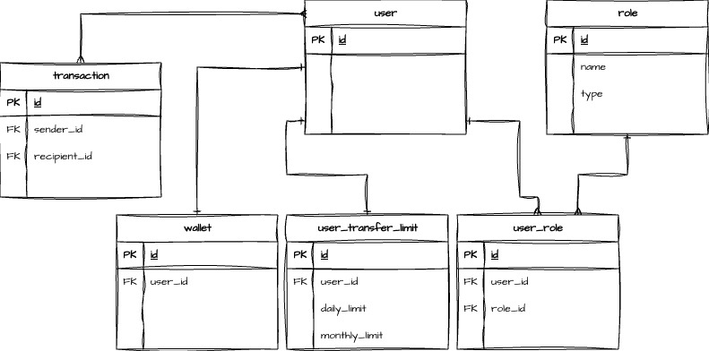

# Maya Requioma MarTech - Send Money Limits Module

A TypeScript + Express.js server with Sequelize ORM and PostgreSQL, containerized with Docker.

## Architectural Design



## API Documentation
- [Swagger URL](http://localhost:3000/api-docs)

## Quick Start with Docker

### Prerequisites
- Docker
- Docker Compose

### Running the Application

1. **Start the services:**
   ```bash
   docker compose up --build
   ```

   This will:
   - Build the Node.js application image
   - Start a PostgreSQL database container
   - Start the application container
   - Wait for the database to be healthy before starting the app

   Wait for the message: `Server is running on port 3000`

2. **Run migrations and seeders** (in a new terminal):
   ```bash
   docker compose exec app npm run migrate
   docker compose exec app npm run seed
   ```

   This creates the database schema and populates initial data (roles, users, wallets, limits, transfers).

3. **Verify the server is running:**
   ```bash
   curl http://localhost:3000/health
   ```

   Expected response:
   ```json
   {
     "status": "ok",
     "message": "Send Money Limits Module is running"
   }
   ```

4. **Stop the services:**
   ```bash
   docker compose down
   ```

   To also remove the database volume:
   ```bash
   docker compose down -v
   ```

## Local Development (without Docker)

### Prerequisites
- Node.js (18+)
- PostgreSQL (locally installed or running)
- npm or yarn

### Setup

1. **Install dependencies:**
   ```bash
   npm install
   ```

2. **Configure environment variables:**
   Create a `.env` file in the root directory:
   ```
   DB_NAME=maya_martech
   DB_USER=postgres
   DB_PASSWORD=your_password
   DB_HOST=localhost
   DB_PORT=5432
   NODE_ENV=development
   JWT=some-secret-key
   ```

3. **Run migrations** (creates database schema):
   ```bash
   npm run migrate
   ```

4. **Run seeders** (populates initial data):
   ```bash
   npm run seed
   ```

5. **Start the development server:**
   ```bash
   npm run dev
   ```
   or with auto-reload:
   ```bash
   npm run dev:watch
   ```

### Database Management

- **Undo last migration:** `npm run migrate:undo`
- **Undo all migrations:** `npm run migrate:undoAll`
- **Undo seeds:** `npm run seed:undo`
- **Undo all seeds:** `npm run seed:undoAll`

## Main APIs:

- Registering a user
```
curl -X 'POST' \
  'http://localhost:3000/api/auth/register' \
  -H 'accept: */*' \
  -H 'Content-Type: application/json' \
  -d '{
  "handleId": "user1@example.com",
  "password": "password123",
  "firstName": "John",
  "lastName": "Doe"
}'
```

- Logging in to authenticate a user
```
curl -X 'POST' \
  'http://localhost:3000/api/auth/login' \
  -H 'accept: */*' \
  -H 'Content-Type: application/json' \
  -d '{
  "handleId": "user@example.com",
  "password": "Password!23"
}'
```

- Sending money
```
curl -X 'POST' \
  'http://localhost:3000/api/v1/transfers' \
  -H 'accept: */*' \
  -H 'idempotency-key: 6fb45a50-0be4-41e3-944b-641338e93d5b' \
  -H 'Authorization: Bearer xxx' \
  -H 'Content-Type: application/json' \
  -d '{
  "recipientId": "b8c41e14-4795-4b2d-90d4-f11ecf2e5e5f",
  "amount": 100.5
}'
```

- Inspecting user's limits
```
curl -X 'GET' \
  'http://localhost:3000/api/v1/limits' \
  -H 'accept: */*' \
  -H 'Authorization: Bearer xxx'
```

- Viewing a user's transaction history
```
curl -X 'GET' \
  'http://localhost:3000/api/v1/transfers/history?limit=50&offset=0' \
  -H 'accept: */*' \
  -H 'Authorization: Bearer xxx'
```

4. **Stop the services:**
   ```bash
   docker compose down
   ```

   To also remove the database volume:
   ```bash
   docker compose down -v
   ```

## Local Development (without Docker)

### Prerequisites
- Node.js 20+
- PostgreSQL 16+

### Setup

1. **Install dependencies:**
   ```bash
   npm install
   ```

2. **Update `.env` file:**
   ```
   DB_HOST=localhost
   DB_PORT=5432
   DB_NAME=maya_martech
   DB_USER=postgres
   DB_PASSWORD=your_password
   PORT=3000
   NODE_ENV=development
   JWT_SECRET=your_secret
   ```

3. **Run migrations and seeders:**
  ```
  npm run migrate
  npm run seed
  ```

  Seeders will generate an admin user and multiple users with wallets. See [seeders folder](seeders/).

4. **Build and run:**
   ```bash
   npm run dev
   ```

## Available Scripts

- `npm run build` — Compile TypeScript to JavaScript
- `npm run dev` — Build and run locally
- `npm start` — Run compiled JavaScript
- `npm test` — Run tests

## Project Structure

```
src/
├── config/
│   └── database.ts          # Sequelize configuration
├── models/
│   └── User.ts              # Example User model
└── index.ts                 # Express server setup
```

## Docker Configuration

- **`Dockerfile`** — Builds the Node.js application
- **`docker-compose.yml`** — Orchestrates the app and PostgreSQL services
- **`.dockerignore`** — Excludes unnecessary files from the Docker image

The PostgreSQL container:
- Uses Alpine Linux (lightweight)
- Includes health checks
- Stores data in a named volume for persistence
- Exposes port 5432

## Environment Variables

| Variable | Default | Docker Value | Notes |
|----------|---------|--------------|-------|
| DB_HOST | localhost | postgres | Service name in docker-compose |
| DB_PORT | 5432 | 5432 | - |
| DB_NAME | maya_martech | maya_martech | - |
| DB_USER | postgres | postgres | - |
| DB_PASSWORD | password | password | Change in production |
| PORT | 3000 | 3000 | - |
| NODE_ENV | development | development | - |
| JWT_SECRET | some-secret-key | some-secret-key | Change in production

## Assumptions and Scope

1. Basic authentication only for this app, log out, refresh token functionalities not included.
2. Administrator role can perform CRUD operations for all users.
3. User role can ONLY perform CRUD operations for their own records.
4. The transaction lifecycle will consist of only two statuses: **COMPLETED** and **FAILED**. Transactions are processed synchronously within an atomic database transaction, ensuring that all operations either succeed or roll back entirely.
5. A user can only have one wallet. The API for creating a wallet fails when a user already has an existing one.
6. All money transfer endpoints support idempotency via the `idempotency-key` header:

## Brief Notes before Production Launch
- [ ] Generate a separate `JWT_SECRET` for the production environment.
- [ ] Generate a different password for the database in the production environment.
- [ ] Remove hardcoded password for users in the seeders
- [ ] Create a production container image. Currently, the image is suitable only for development purposes.
- [ ] Refactor auth api to use tokens in cookies instead of in the response body.
